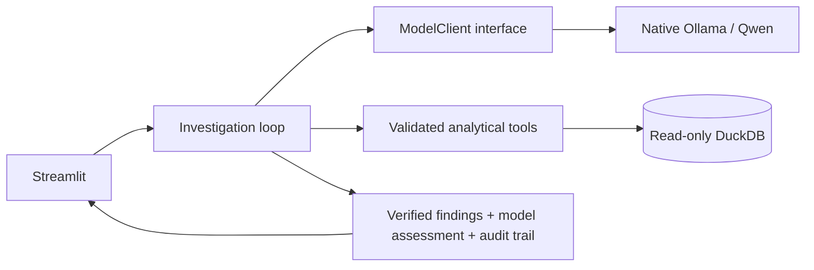

# Incident Intelligence Agent

A local-first portfolio MVP for investigating statistical anomalies in historical
Brazilian Olist e-commerce data. Streamlit connects a local Ollama/Qwen model to
validated, read-only DuckDB analytical tools, producing verified numerical
findings, model-written hypotheses, and a transparent tool-call audit trail.

The current runtime uses Ollama's native tool calling. A small model adapter
interface prepares the MVP for LangChain integration; LangChain is not yet
installed or used by the application.

## What works

- Select an actual stored anomaly in the Streamlit dashboard.
- Collect deterministic baseline evidence, then execute additional tools selected
  by the model, with the two sources clearly labeled.
- Render numeric findings from database results and ask the model for a short,
  cautious assessment of explanations and next checks.
- Retain the report, tool results, model name, and elapsed time across UI reruns.
- Report unavailable models, timeouts, invalid calls, and missing data explicitly.

## Run locally

From the repository root, with the prepared Olist database at
`data/incident_intelligence.duckdb`:

```bash
source .venv/bin/activate
python -m pip install -r requirements-mvp.txt
ollama pull qwen3:4b-instruct
export INCIDENT_MODEL=qwen3:4b-instruct
python -m streamlit run src/app.py --server.address 127.0.0.1
```

Open <http://localhost:8501> and investigate `2017-11-24`. Verified database
observations for that day are **R$149,916.58 item sales** and **1,147 distinct
delivered orders**. The instruct-model integration previously completed in
approximately six seconds on the development laptop; response time varies.

See [README-MVP.md](README-MVP.md) for virtual-environment setup, Ollama service
checks, model selection, missing-data guidance, and test commands. Raw datasets,
the generated database, and model weights are intentionally excluded from Git.

## Architecture and LangChain preparation



`src/model_clients.py` owns the model transport and normalizes replies and tool-call
identifiers. `src/incident_agent.py` owns dispatch, budgets, evidence provenance,
and report generation. A future LangChain adapter can implement the same interface
without changing the SQL tools, dashboard, or safety checks.

The concrete migration plan and message contract are in
[docs/LANGCHAIN.md](docs/LANGCHAIN.md). This preparation adds no framework or cloud
service dependency.

## Test

```bash
python -m unittest discover -s tests -v
INCIDENT_MODEL=qwen3:4b-instruct python tests/live_smoke.py
```

The first command uses temporary DuckDB fixtures and fake model responses. The
second requires the actual Olist database and local Ollama model, drives the
Streamlit button, checks real model-selected tool execution and report persistence,
and verifies that the database hash remains unchanged.

Item sales exclude freight and are neither recognized accounting revenue nor
profit. A statistical anomaly is not automatically a business incident. Black
Friday is calendar context, not proof of a promotion. Model-written hypotheses
still require review against the evidence.
