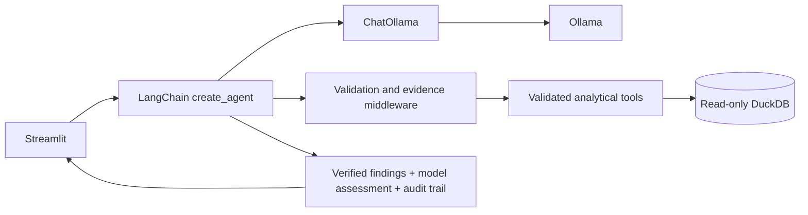

# Incident Intelligence Agent

Incident Intelligence Agent is a local business intelligence application for
exploring metrics, investigating unusual observations, and asking follow-up
questions through Streamlit. It supports configured business metrics over
prepared DuckDB datasets and includes a dedicated investigation workflow for
historical Brazilian Olist e-commerce data.

A LangChain agent uses a local Ollama-hosted Qwen model to choose from a defined
set of analytical tools.
Python queries DuckDB, calculates numerical findings, and returns the evidence
for the model's assessment. Reports distinguish database observations from
hypotheses and include a tool-call log showing how the evidence was collected.
Data processing and model inference run locally, without cloud API keys.

**Status: MVP under active development.** The current release focuses on the
complete discovery, investigation, and follow-up workflow. Features, interfaces,
and implementation details may change as the application develops.
The longer-term goal is a business intelligence agent that works across configured
business datasets through controlled SQL tools. See [Future direction](#future-direction).

## Current capabilities

- Ask the agent to discover stored anomalies, filter/rank them, and investigate
  a result without selecting a date manually.
- Collect deterministic baseline evidence, then execute additional tools selected
  by the model, with the two sources clearly labeled.
- Render numeric findings from database results and ask the model for a short,
  cautious assessment of explanations and next checks.
- Retain the report, tool results, model name, and elapsed time across UI reruns.
- Discuss the investigation in chat: test a hypothesis, compare dates, and inspect
  each reply's additional tool calls and database evidence.
- Request database-backed graphs of daily sales/orders/AOV, category sales, or
  order statuses; keep them with the reply across reruns.
- Report unavailable models, timeouts, invalid calls, and missing data explicitly.
- Define approved datasets and metrics in JSON, including record grain, joins,
  date fields, equality filters, dimensions, units, and aggregation rules.
- Use the same business tools and prompt across Olist and a synthetic warehouse
  dataset for totals, trends, comparisons, anomaly discovery, and charts.

## Run locally

From the repository root, with a prepared Olist database or the three source CSVs
in `data/`, Python 3, and Ollama installed:

```bash
# Create the environment if it does not already exist.
python3 -m venv .venv
source .venv/bin/activate
python -m pip install -r requirements-mvp.txt
python src/prepare_data.py
ollama pull qwen3:4b-instruct
export INCIDENT_MODEL=qwen3:4b-instruct
export INCIDENT_BACKEND=langchain
python -m streamlit run src/app.py --server.address 127.0.0.1
```

Ollama must be running before pulling or using the model. If its service is not
running, start `ollama serve` in another terminal. Data preparation checks an
existing database read-only; it imports CSVs and calculates anomaly flags only
when the destination database is absent.

Open <http://localhost:8501>. **Ask the agent** is the default workspace. Try:

1. “Find the three biggest sales spikes by item sales in November 2017.”
2. “Investigate the first one.”
3. “Could a promotion explain that? What evidence would test it?”

For graphs, ask “Plot daily sales for November 2017,” then “Graph the top five
categories on the day with the highest sales.” The model selects `create_graph`;
Streamlit plots actual query results. Graph requests also work as the first message.
Open **About the agent and its tools** in the app for a quick explanation.

The model selects the read-only `find_anomalies` tool, then analytical tools for
the dates it discovers. Python renders the actual search results and numerical
evidence; each reply includes a tool audit trail. **New conversation** clears the
discussion. The agent searches the existing statistical detector's stored flags;
it does not regenerate the database or run live monitoring.

**Explore a date** retains the optional dashboard and report workflow. Known
observations for `2017-11-24` are **R$149,916.58 item sales** and **1,147 distinct
delivered orders**. Questions can use saved evidence or trigger more read-only
tool calls; no additional call is claimed when the agent reuses context.

Raw datasets, the generated database, and model weights are intentionally excluded
from Git.
The [complete agent guide](docs/AGENT_GUIDE.md) explains the detector, every tool,
graph options, model/runtime responsibilities, memory, safety limits, and testing.

## Configured business datasets

Set `INCIDENT_DATASET_CONFIG` to launch the reusable business workspace instead
of the dedicated Olist workspace. Configuration is supplied by the operator;
the model cannot change definitions or select another database file.
No manual anomaly selection is required.

For the existing Olist database:

```bash
source .venv/bin/activate
python -m pip install -r requirements-mvp.txt
python src/business_tools.py configs/olist.json
export INCIDENT_MODEL=qwen3:4b-instruct
export INCIDENT_BACKEND=langchain
INCIDENT_DATASET_CONFIG=configs/olist.json python -m streamlit run src/app.py --server.address 127.0.0.1
```

The validation command prints the approved metric catalogue and never changes
the database. Try “Find item sales spikes in November 2017,” then “Investigate
the first one and compare it with the previous Friday,” and “Graph item sales
for that month.” The configured metrics include delivered item sales, distinct
delivered orders, and pooled average order value.

To try a different schema, grain, and business domain:

```bash
python src/prepare_demo.py
python src/business_tools.py configs/warehouse_demo.json
INCIDENT_DATASET_CONFIG=configs/warehouse_demo.json python -m streamlit run src/app.py --server.address 127.0.0.1
```

This creates a separate, clearly **synthetic** warehouse database with one row
per shift. It never overwrites an existing destination or modifies Olist data.
If the demo database already exists, use that copy; preparation refuses to replace it.
Try “Find units shipped spikes in February 2025,” “Investigate the first anomaly
and break it down by warehouse,” and “What was handling time per unit on that day?”
Independent demo references for February 14 are **480 shipped units**, **2
completed shifts**, and **2.375 handling minutes per unit**. The previous Friday
has 160 shipped units. The weighted rate is not the simple average of warehouse rates.

### Define another dataset

Start from either [Olist](configs/olist.json) or
[warehouse](configs/warehouse_demo.json) configuration and point it at a prepared
local DuckDB file. Database paths are relative to the JSON file; relative
configuration paths are resolved from the repository root.

| Definition | Meaning |
| --- | --- |
| `tables` | Approved table aliases, physical base-table names, and unique, non-null record-grain columns |
| `joins` | Named `inner` or `left` joins targeting a different table's single-column unique key |
| Metric `source`, `joins`, `date` | Fact table, ordered approved joins, and a DATE or TIMESTAMP field |
| Metric `calculation` | `sum`, `average`, `count`, `count_distinct`, or a ratio of two approved aggregate terms |
| Metric `filters` | Fixed equality predicates, with values passed as SQL parameters; null means `IS NULL` |
| Metric `dimensions` | Approved grouping names mapped to configured columns |
| Metric `label`, `description`, `unit`, `precision` | Business meaning, display units, and rounding precision |
| `default_metric` | Metric highlighted when the dataset workspace opens |

`python src/business_tools.py path/to/config.json` checks configuration, columns,
types, key uniqueness, and join compatibility before the model is used. Duplicate
lookup keys are rejected to prevent joins multiplying facts. Formulas and
identifiers cannot contain SQL expressions. Configuration errors fail explicitly.
The dataset expander shows the definitions for review, including filters and joins.

### Business tools and evidence

| Tool | Purpose |
| --- | --- |
| `describe_business_dataset` | Approved metric definitions, units, dimensions, date coverage, and missing-date counts |
| `query_metric` | A total, daily series, or dimension breakdown |
| `compare_metric_periods` | Two period values, calculated difference, percentage change, and direction |
| `find_metric_anomalies` | On-demand, read-only anomaly discovery for an approved metric |
| `create_metric_graph` | A daily line or dimension bar chart from actual metric observations |

Totals, comparisons, and anomaly searches cover at most 366 days per requested
period. Daily series and charts cover at most 90 days; dimension results contain
at most 15 groups. Each SQL statement has a 10-second timeout. These operations
use fixed query templates, quoted approved identifiers, and parameterized values;
the agent has no arbitrary SQL execution tool.

Business anomaly discovery compares each complete observation with the median of
four previous observed matching weekdays, using up to 365 days before the search
start. Its default absolute deviation threshold is 30%. It calculates flags on
demand without creating or updating a stored anomaly table. Missing values,
insufficient history, and non-positive baselines are reported as unassessed.
Empty aggregates and zero denominators remain unknown. Comparisons warn about
unequal period lengths and compute ratios from pooled values.

Python constructs the factual answer and numerical tables directly from tool
results. Model prose is kept in a separate **Model discussion — unverified**
expander, because even a model with correct tool results can misstate a count,
ratio denominator, or whether a threshold was exceeded. It never replaces the
verified answer or becomes database evidence. The
trace retains full SQL templates, parameter values, results, and tool-call IDs;
Qwen receives compact evidence and graph/long-series previews to fit local memory.
Conversation history resets when the configuration fingerprint or database file
size/modification time changes. SQL and source data are never edited by chat.

Unset `INCIDENT_DATASET_CONFIG` and restart Streamlit to return to the original
Olist workspace. The original data preparation command and date explorer remain available.

## Prepare the data

The application reads `data/incident_intelligence.duckdb`, resolved relative to
the repository. It requires the tables `orders`, `order_items`, `products`, and
`detected_anomalies`.

```bash
python src/prepare_data.py
```

For an existing database, this command checks the required tables and prints row
counts through a read-only connection. CSVs are not required in that case, and
the database remains unchanged.

For a new database, place these source files directly in `data/`:

- `olist_orders_dataset.csv`
- `olist_order_items_dataset.csv`
- `olist_products_dataset.csv`

Preparation imports the source columns and calculates anomaly flags in a temporary
database before publishing the completed file. It never replaces an existing
destination. Missing sales days are not filled with zeros.

If an existing database is incomplete, restore a prepared copy or build a separate
one without overwriting it:

```bash
python src/prepare_data.py --data-dir data --db data/rebuilt.duckdb
```

The `--db` option changes only the preparation destination. To use the rebuilt
copy, stop the application, move the original database to a backup path, then
move the completed replacement to `data/incident_intelligence.duckdb`. Keep the
backup. Application startup does not run preparation automatically.

## LangChain runtime

LangChain is the only supported backend and is installed with
`requirements-mvp.txt`. Its `create_agent` runtime manages model calls, tool
routing, and continuation until a validated answer is ready. Application
middleware enforces argument validation, budgets, evidence requirements, and the
tool-call audit trail. The former custom Ollama loop and direct native client
have been removed.

`ChatOllama` connects LangChain to the local Ollama service that hosts Qwen.
Ollama is still required for model inference. LangChain's agent runtime includes
LangGraph as an internal dependency; no separate graph service or cloud API is
needed. LangSmith tracing is disabled around the complete agent run.
`requirements-langchain.txt` remains a compatibility alias for the main
requirements file. An old `INCIDENT_BACKEND=native` override produces an
instruction to remove it or set it to `langchain`; there is no native fallback.

## Configuration and session limits

Set environment variables in the terminal that launches Streamlit. Restart the
application after changing them.

| Variable | Default | Purpose |
| --- | --- | --- |
| `INCIDENT_MODEL` | `qwen3:4b` | Installed Ollama model tag; the launch instructions select the tested `qwen3:4b-instruct` variant |
| `INCIDENT_BACKEND` | `langchain` | Only supported backend; an override is unnecessary unless replacing an old setting |
| `OLLAMA_HOST` | `http://127.0.0.1:11434` | Local Ollama service address |
| `INCIDENT_TIMEOUT_SECONDS` | `90` | Timeout per model request, from 1 to 300 seconds |
| `INCIDENT_DATASET_CONFIG` | Unset | Operator-owned JSON path; enables the reusable business workspace |

The LangChain runtime permits seven model rounds by default and at most eight model tool
attempts, with an 8,000-character limit per tool result and a 4,096-token model
context. It checks an overall budget of twice the request timeout between rounds
and limits new requests to the remaining time. Cold model loading may take longer
than a warm request.

Each workspace retains at most 12 exchanges in the current session. Model requests
use up to three recent successful exchanges within 2,000 characters, plus bounded
evidence within 3,500 characters. Questions are limited to 1,000 characters; a
12,000-character request guard complements the model context limit.

**New conversation** clears the main chat. In **Explore a date**, **Clear
conversation** clears follow-ups; running a new investigation resets both its
report and discussion. Model/backend changes require a fresh conversation or
investigation. Switching workspaces preserves their separate session histories.

## Architecture



`src/langchain_runtime.py` builds the LangChain agent and applies the per-run
validation, timeout, tool-count, and report-completion policies.
`src/langchain_client.py` handles ChatOllama requests and actionable model errors;
`src/model_clients.py` defines the reply contract and selects the single supported
client. The contract also allows offline tests to inject fake replies into the
real LangChain runtime. `src/incident_agent.py` prepares bounded context and
renders numerical findings from the database evidence.
`ask_agent()` handles chat-first discovery; `find_anomalies()` supports date ranges,
spikes/drops, sorting, and pagination. Percentage deviation is the default ranking;
asking for highest item sales selects the sales ranking instead.

`src/prepare_data.py` imports the three Olist CSVs and calculates anomaly flags
for a new database. The detector compares daily item sales against the median of
the previous four matching weekdays and flags absolute deviations of at least
30%. Existing databases are checked read-only. `src/agent_tools.py` provides the
fixed analytical queries used during investigations; the model has no arbitrary
SQL, shell, or filesystem-write tool.

Setup, the message contract, and implementation details are in
[docs/LANGCHAIN.md](docs/LANGCHAIN.md).

## Verify the installation

```bash
python -m pip check
python src/incident_agent.py 2017-11-24
```

Run these commands from the activated environment with the prepared database and
Ollama available. The CLI runs an investigation for the supplied date and prints
the report and tool-call trace. With the original Olist data, the November 24
check should show the item sales and delivered-order count listed above.
The separate development test suite is kept locally and is not distributed in
this repository.

Verification on October 28, 2026: **155 offline tests passed**, including the
existing Olist workflows and the configured business engine, LangChain runtime,
and Streamlit UI. Real `qwen3:4b-instruct` integration tests passed for configured
Olist (23.9 seconds) and the unrelated warehouse schema (20.0 seconds), covering
model-selected anomaly discovery, reference-based investigation, period comparison,
rendered charts, weighted ratios, and rerun persistence. Olist retained
R$149,916.58 item sales and 1,147 distinct delivered orders on November 24;
the warehouse reference rate was 2.375 minutes per unit. Database hashes were
unchanged. These are individual runs, not latency guarantees or validation of
every model-written interpretation. Streamlit AppTest verifies runtime and chart
payloads, not browser pixel layout. The original Olist dashboard/report/follow-up
regression also passed with real Qwen in 13.8 seconds and an unchanged database.

## Troubleshooting

- **Ollama is unavailable:** run `ollama list` to check connectivity. Start
  `ollama serve` in another terminal if the service is stopped. Ollama installation
  instructions are at <https://docs.ollama.com/linux>.
- **The model is missing:** run `ollama pull qwen3:4b-instruct`, export
  `INCIDENT_MODEL=qwen3:4b-instruct`, and restart Streamlit.
- **Replies time out or expose reasoning:** use the instruct variant selected by
  the launch instructions. The tested `qwen3:4b` tag used a thinking variant that
  caused long waits. Check `ollama ps`; if needed, increase
  `INCIDENT_TIMEOUT_SECONDS` within its supported range.
- **The database or tables are missing:** follow the data preparation instructions
  above. An incomplete existing database must be restored or rebuilt separately.
- **No anomalies are listed:** inspect the row counts from `prepare_data.py`.
  A valid dataset can have no deviations above the detector threshold; the chat
  can still query daily metrics and create graphs.
- **An investigation fails:** inspect its retained tool-call trace. Invalid tool
  arguments, exhausted budgets, and model failures produce explicit errors with
  any evidence already collected.

## MVP scope and limitations

The dedicated Olist importer and original workspace retain their Olist-specific
schema and sales semantics. The configured business workspace supports different
schemas through explicit metric definitions. It currently requires prepared local
DuckDB base tables and manually reviewed JSON configuration; automatic CSV/Parquet
onboarding, external database connections, arbitrary formulas, and inferred joins
are not implemented. Joins must target single-column unique keys, and only fixed
equality filters are supported in this first configuration format.

The original workspace searches precomputed Olist flags; configured business
metrics support on-demand anomaly calculations. The application does not provide
live monitoring, automated incident response, or
confirmed root-cause analysis. Graphs support daily sales, orders, average order
value, category sales, and order statuses over ranges of up to 90 days.
Conversation history is limited to the current Streamlit session.

Item sales exclude freight and are neither recognized accounting revenue nor
profit. A statistical anomaly is not automatically a business incident. Black
Friday is calendar context, not proof of a promotion. Model-written hypotheses
still require review against the evidence.

## Future direction

### Intended product

The goal is a local-first business intelligence agent that helps people explore
their business data, investigate changes, and collaborate on follow-up questions.
Anomaly investigation would become one capability alongside metric exploration,
period comparisons, segment analysis, and chart creation.

A user would connect or import a dataset, review its structure, confirm the
business meaning of its metrics, and ask questions in plain language. The agent
would select controlled SQL-backed tools and return an explanation, supporting
tables or charts, and a trace of the queries and definitions used. When the data
cannot answer a question, it would explain what is missing or ask for clarification.

Supporting different datasets requires explicit business definitions. A column
named `amount` could represent item sales, payments, costs, or refunds; schema
inspection alone cannot establish its meaning. The intended product would make
those definitions visible and reusable rather than silently guessing them.

### Proposed development path

The configuration milestone implements part of this direction. Remaining work
is marked below; priorities may change as additional datasets expose new requirements.

| Stage | Status | Next development |
| --- | --- | --- |
| 1. Dataset onboarding | Prepared DuckDB validation available | Guided local CSV/Parquet import, schema profiling, and candidate relationship review |
| 2. Business definitions | JSON definitions implemented | Guided metric setup, richer filters, and additional relationship shapes |
| 3. Reusable SQL tools | Totals, trends, breakdowns, comparisons, and charts implemented | Broaden supported analyses while keeping SQL controlled |
| 4. Broader investigations | Configured-metric anomaly discovery implemented | Additional baseline strategies, seasonality handling, and stronger data-quality analysis |
| 5. Reusable analysis | Configurations are reusable; conversations remain session-only | Explicitly saved investigations and report/table/chart exports |

Additional database connectors and scheduled checks could follow once the local
workflow works reliably across multiple datasets. They are outside the current MVP.

### SQL tool boundary

The implemented configuration layer keeps query execution under application
control. The agent requests a structured analysis using approved metrics,
dimensions, and date ranges. Python validates requests and constructs read-only,
parameterized SQL from approved definitions, enforcing row limits and timeouts.
Future extensions should preserve this boundary.

Business definitions and source identifiers would be validated separately from
filter values. Query results, metric definitions, and data coverage would remain
available in the evidence trace, while the model would explain results and propose
hypotheses. This preserves the current separation between measured observations
and generated interpretation as the range of questions expands.

### Current milestone and next step

The configuration layer represents Olist through approved joins and sales metrics
and the warehouse example through shift records, shipped units, and a weighted
handling-time metric. Both use the same business prompt, tool implementations,
and LangChain runtime, with independent reference answers for numerical checks.

The next step is guided dataset onboarding and metric-definition review, followed
by validation against another real business dataset. This should make configuration
easier without asking the model to guess what financial or operational measures mean.
