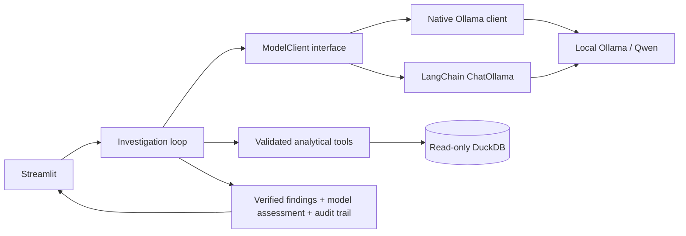

# Incident Intelligence Agent

A local-first portfolio MVP for investigating statistical anomalies in historical
Brazilian Olist e-commerce data. Streamlit connects a local Ollama/Qwen model to
validated, read-only DuckDB analytical tools, producing verified numerical
findings, model-written hypotheses, and a transparent tool-call audit trail.

Choose native Ollama tool calling or the optional LangChain `ChatOllama` backend.
Both use the same local model, validated tools, bounded investigation loop, and
verified report renderer. Native Ollama remains the default.

## What works

- Ask the agent to discover stored anomalies, filter/rank them, and investigate
  a result without selecting a date manually.
- Collect deterministic baseline evidence, then execute additional tools selected
  by the model, with the two sources clearly labeled.
- Render numeric findings from database results and ask the model for a short,
  cautious assessment of explanations and next checks.
- Retain the report, tool results, model name, and elapsed time across UI reruns.
- Discuss the investigation in chat: test a hypothesis, compare dates, and inspect
  each reply's additional tool calls and database evidence.
- Report unavailable models, timeouts, invalid calls, and missing data explicitly.

## Run locally

From the repository root, with a prepared Olist database or the three source CSVs
in `data/`:

```bash
source .venv/bin/activate
python -m pip install -r requirements-mvp.txt
python src/prepare_data.py
ollama pull qwen3:4b-instruct
export INCIDENT_MODEL=qwen3:4b-instruct
python -m streamlit run src/app.py --server.address 127.0.0.1
```

Open <http://localhost:8501>. **Ask the agent** is the default workspace. Try:

1. “Find the three biggest sales spikes by item sales in November 2017.”
2. “Investigate the first one.”
3. “Could a promotion explain that? What evidence would test it?”

The model selects the read-only `find_anomalies` tool, then analytical tools for
the dates it discovers. Python renders the actual search results and numerical
evidence; each reply includes a tool audit trail. **New conversation** clears the
discussion. The agent searches the existing statistical detector's stored flags;
it does not regenerate the database or run live monitoring.

**Explore a date** retains the optional dashboard and report workflow. Known
observations for `2017-11-24` are **R$149,916.58 item sales** and **1,147 distinct
delivered orders**. Questions can use saved evidence or trigger more read-only
tool calls; no additional call is claimed when the agent reuses context.

See [README-MVP.md](README-MVP.md) for virtual-environment setup, Ollama service
checks, model selection, missing-data guidance, and test commands. Raw datasets,
the generated database, and model weights are intentionally excluded from Git.

## Use LangChain

After activating `.venv` and preparing the same local database/model:

```bash
python -m pip install -r requirements-langchain.txt
INCIDENT_BACKEND=langchain INCIDENT_MODEL=qwen3:4b-instruct python -m streamlit run src/app.py --server.address 127.0.0.1
```

The optional dependency file includes the base MVP dependencies. No cloud API keys
or LangGraph package are required. Set `INCIDENT_BACKEND=native` to use the native
client. Restart Streamlit after changing environment variables. The report records
which backend and model produced it; there is no silent fallback between backends.

## Architecture



`src/model_clients.py` defines the adapter contract and native implementation;
`src/langchain_client.py` implements the optional LangChain transport. Both
normalize model replies and preserve request/result tool-call IDs.
`src/incident_agent.py` owns dispatch, budgets, evidence provenance, and report
generation. Adapters expose tool schemas but do not execute analytical functions.
`ask_agent()` handles chat-first discovery; `find_anomalies()` supports date ranges,
spikes/drops, sorting, and pagination. Percentage deviation is the default ranking;
asking for highest item sales selects the sales ranking instead.

`src/prepare_data.py` consolidates the former `explore_data.py` and
`detect_anomalies.py` setup steps. It imports the three Olist CSVs and applies the
original four-weekday median detector when the destination database is absent.
Existing databases are checked read-only. The old `analytics.py` queries are
covered by `src/agent_tools.py`; all three superseded scripts have been removed.
Inline comments explain the setup safeguards, SQL semantics, model adapters,
investigation loop, and Streamlit session state.

Setup, the message contract, and implementation details are in
[docs/LANGCHAIN.md](docs/LANGCHAIN.md). LangChain imports are lazy, remote tracing
is disabled, and the base installation remains independent of LangChain.

## Test

```bash
python -m unittest discover -s tests -v
INCIDENT_BACKEND=native INCIDENT_MODEL=qwen3:4b-instruct python tests/live_discovery.py
INCIDENT_BACKEND=langchain INCIDENT_MODEL=qwen3:4b-instruct python tests/live_discovery.py
```

The first command uses temporary DuckDB fixtures and fake model responses. Optional
LangChain adapter tests skip when its dependencies are absent. The live commands
require the actual Olist database and local Ollama model. They ask for anomalies,
investigate a returned result without a date selection, and ask a hypothesis
follow-up, checking persistence and an unchanged database hash. The separate
`tests/live_smoke.py` retains the optional date explorer/report/chat regression.

Item sales exclude freight and are neither recognized accounting revenue nor
profit. A statistical anomaly is not automatically a business incident. Black
Friday is calendar context, not proof of a promotion. Model-written hypotheses
still require review against the evidence.
