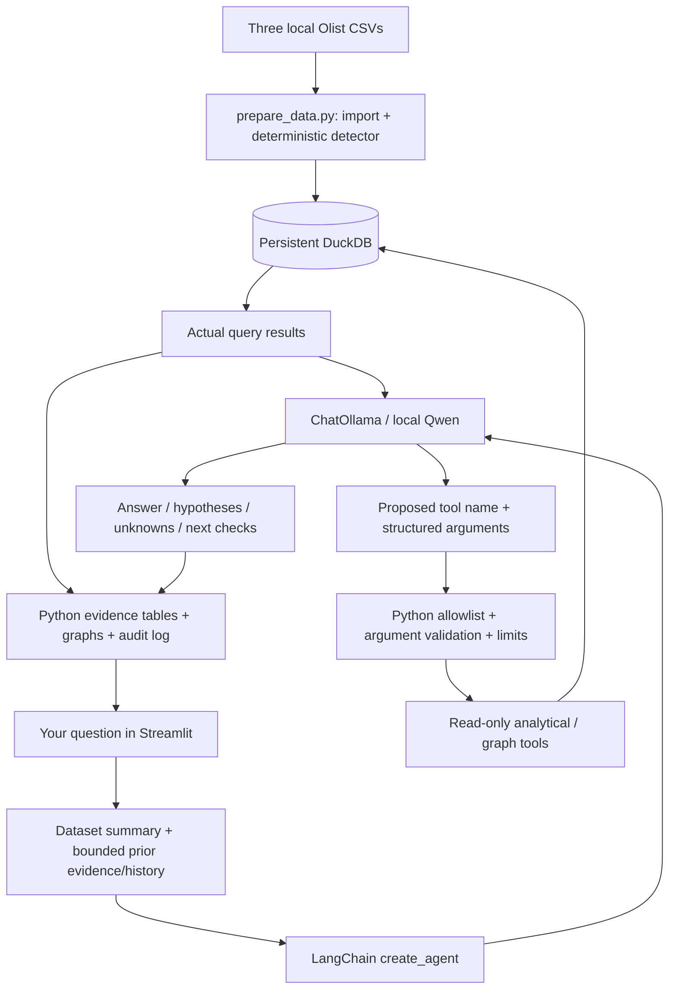

# How the Incident Intelligence Agent works

The agent helps you explore unusual sales days in historical Brazilian Olist
e-commerce data. You ask questions in Streamlit. A LangChain agent uses a local
Ollama/Qwen model to choose analytical tools, Python validates and runs them against DuckDB, and the app
displays the returned evidence, graphs, and the model's interpretation.

The statistical detector identifies unusual observations. The language model
decides what evidence to inspect and discusses possible explanations with you.
A statistical anomaly alone does not establish a business incident or its cause.

## A typical conversation

1. “Find the three biggest sales spikes by item sales in November 2017.”
2. “Investigate the first one.”
3. “Plot daily sales for that month.”
4. “Graph the top five categories on the day with the highest sales.”
5. “Could a promotion explain this? What records would test that?”

The default **Ask the agent** workspace needs no manually selected anomaly.
The model can filter and rank stored anomalies, query dates from its search
results, create graphs, and answer follow-ups using saved evidence. Each reply
shows the model/backend, elapsed time, and its own expandable tool audit trail.

**Explore a date** is an optional dashboard for a known date. It shows detector
metrics and a nearby-sales chart. **Investigate with local AI** runs the original
date-specific report, then **Discuss this investigation** supports follow-ups and
requested graphs. The two workspaces have separate conversation histories.

## The complete workflow



1. The app reads dataset coverage and counts. At the start of a chat turn,
   `ask_agent()` supplies a dataset summary plus a bounded selection of previous
   evidence and recent messages.
2. The model receives the allowed tool schemas. It returns structured proposals,
   such as `find_anomalies(direction="spikes", sort_by="sales", limit=3)`.
3. Python checks the proposed name against the tool allowlist, checks argument
   names, and lets each tool validate its dates, enums, and numeric limits.
4. The tool opens DuckDB read-only and executes fixed, parameterized SQL.
   The model does not write the SQL or execute Python code.
5. Python records arguments, results, status, round, and tool-call ID in the
   trace. Results or actionable errors go back to the model. It can select
   another tool or finish its answer.
6. Python builds numerical evidence tables, weighted AOV comparisons, and graphs
   from actual values. The model contributes the interpretation and next checks.
   Session state preserves the reply, tool results, and graph data on reruns.

In a fresh conversation, the model must successfully select `find_anomalies` for
discovery or `create_graph` for a graph request before the turn can finish.
An unspecified graph can instead prompt a date/metric clarification without
pretending a graph was made.
A seeded count or generated list does not qualify as model-selected discovery.
Later explanations can reuse existing evidence without another tool call; the
trace reports zero new model-selected calls in that case.

## Every tool the model can use

| Tool | What it returns | Inputs and limits |
| --- | --- | --- |
| `get_dataset_summary()` | Historical first/last purchase dates, total orders, stored anomaly count | No arguments |
| `find_anomalies(...)` | A page of stored dates, actual/expected item sales, deviations, total matching count, and whether another page exists | Optional inclusive `start_date`/`end_date`; `direction`: `both`, `spikes`, `drops`; `sort_by`: `deviation`, `sales`, `date`; `limit` 1–10, default 5; `offset` 0–10000 |
| `get_anomaly(day)` | Detector observation and baseline for one stored flag, or a missing-anomaly result | ISO date `YYYY-MM-DD` |
| `get_daily_metrics(day)` | Delivered-order item sales, distinct orders, item count, average order value | ISO purchase date |
| `get_weekday_history(day, weeks=4)` | Prior observed matching weekdays and their sales/order baselines | ISO date; `weeks` 1–8 |
| `get_sales_by_category(day, limit=10)` | Leading categories with sales, distinct orders in each category, and item counts | ISO date; `limit` 1–15 |
| `get_order_status_breakdown(day)` | Orders grouped by their final recorded status, including canceled orders | ISO purchase date |
| `create_graph(graph_type, start_date, end_date=None, limit=10)` | Validated chart description, actual observations, min/max summary, and interpretation notes | Five graph types below; inclusive range of at most 90 days; `limit` 1–15 for categories/statuses |

The default anomaly ranking is **absolute percentage deviation**. A small sales
day with a very small baseline can rank highly. Ask for **highest actual item
sales** to rank by that measure instead; neither ranking is an estimate of
business damage. Ask for another page when `has_more` is true.

`list_anomalies()` and `get_sales_window()` support the optional dashboard.
They are application helpers, outside the model's tool allowlist.
`prepare_data.py` is a separate setup command, also outside that allowlist.

## Requested graphs

| `graph_type` | Chart and scope | Example question |
| --- | --- | --- |
| `daily_sales` | Daily delivered-order item sales by purchase date | “Plot daily sales from November 1 to November 30, 2017.” |
| `daily_orders` | Daily distinct delivered orders with matching item records | “Graph delivered orders for that month.” |
| `daily_average_order_value` | Each day's delivered item sales divided by that day's distinct orders | “Show the daily average order value in that period.” |
| `category_sales` | Leading categories by delivered-order item sales across the requested range | “Graph the top five categories on the busiest day.” |
| `order_status` | All orders by final recorded status across the requested range | “Show a bar graph of order statuses on that day.” |

Daily series use a line chart when there is more than one observation. A single
observation uses a bar so its value is visible. Categories and statuses use bars.
Omitting `end_date` means one day. Date ranges and limits are validated before
querying. A requested range above 90 days produces an error asking for a smaller
range; leading-category/status results explicitly report truncation.

Python fixes the chart types, titles, axes, and units. The model chooses the
tool arguments; it cannot supply executable plotting code or an arbitrary chart
specification. Streamlit's existing charts render the returned data, with hover
and zoom behavior provided by Streamlit. No additional graph library is required.

Missing dates are omitted rather than filled with invented zeros. Missing prices
stay unknown. If no matching observations or known prices exist, the reply shows
an explanation instead of an empty or fabricated graph. A category omitted by a
top-N limit is unknown, not zero; a lower rank does not imply lower sales.

Every returned point stays in the tool trace and session state. To keep Qwen's
context small, the model receives the chart metadata, min/max summary, and a
clearly labeled preview of at most five points. Streamlit uses **all** returned
points. The model can make another analytical call when it needs more detail.
Graph turns use a shorter focused prompt, verified prior results, and brief
previous user questions instead of older generated interpretations. For explicit
English plotting commands with known dates, the loop requires a successful graph
result and checks clearly requested metric kinds; Qwen still selects the call,
dates, and limits. Unknown dates can prompt clarification.

Graphs remain visible across ordinary reruns and subsequent questions until
their exchange is cleared or leaves the 12-exchange session window. If graph
creation succeeds but the final model reply fails, the verified graph remains
available alongside the visible failure and partial trace.

## The data and detector

The database is `data/incident_intelligence.duckdb`, resolved relative to the
repository rather than a machine-specific absolute path.

| Table | Purpose |
| --- | --- |
| `orders` | Order IDs, purchase timestamps, and final recorded statuses |
| `order_items` | Item rows, product IDs, and item prices; joined through `order_id` |
| `products` | Product/category metadata; joined through `product_id` |
| `detected_anomalies` | Flagged dates, actual item sales, expected sales, and percentage deviations |

`prepare_data.py` imports the three Olist CSVs and applies the original detector
only when building an absent database. It builds a complete temporary database
before publishing it and never overwrites an existing destination. For an
existing database, the command checks tables/counts read-only. Runtime discovery,
investigations, and graphs do not rerun the detector or alter these tables.

The detector groups delivered-order item sales by purchase date. Once a weekday
has four prior observations, its expected value is their median:

`deviation_pct = (actual_sales - expected_sales) / expected_sales × 100`

It flags absolute deviations of at least 30%, using a positive baseline. The
current day enters history **after** comparison, preventing look-ahead. Missing
sales days are not filled with zeros. “Four prior matching weekdays” means
observed matching days; data gaps can make them span more than four weeks.

For the existing dataset, November 24, 2017 yields **R$149,916.58 item sales**,
**1,147 distinct delivered orders**, and **1,345 items**. Its daily AOV is
**R$130.70**, compared with **R$148.14** from pooled prior matching-weekday sales
and orders. Python calculates the weighted comparison; dividing the detector's
expected sales by current orders would not produce a historical AOV baseline.

## What the numbers establish

- Item sales sum order-item prices, excluding freight. They are neither
  recognized accounting revenue nor profit.
- Daily delivered-order counts use distinct order IDs after joining items;
  multi-item orders are not counted repeatedly.
- Category order counts can overlap when an order contains multiple categories.
  Missing category metadata is retained as `unknown`.
- Status breakdowns describe final recorded statuses for orders purchased on a
  date. They do not reconstruct the statuses observed on that day or establish
  shipping delays or conversion rates.
- Black Friday is calendar context. The data contains no campaign records that
  establish a promotion's existence or causal impact.

Database observations and Python calculations are distinct from model-written
hypotheses. Qwen can still overstate trends or invent typical promotional
behavior despite instructions. Review its interpretation against the evidence;
tool/graph tests do not certify every semantic claim in generated prose.

## Ollama, Qwen, and LangChain

Ollama hosts the local language model. The tested launch configuration selects
`qwen3:4b-instruct`; the repository's default without an override remains
`qwen3:4b`. On the tested machine that default tag is a mandatory-thinking
checkpoint, which explained earlier long waits and reasoning leakage.

LangChain is the only backend and is selected by default. Its `create_agent`
runtime controls model/tool iteration; `ChatOllama` handles local model requests.
Application middleware enforces tool validation, budgets, trace logging, evidence
requirements, and report formatting. The former native client and custom Ollama
loop have been removed. An old `INCIDENT_BACKEND=native` setting must be removed
or changed to `langchain` before restarting the application.

Ollama remains the local model server. LangChain includes LangGraph as an internal
dependency; no separate graph service is required. LangSmith tracing is disabled
around the complete agent invocation. Factual correctness still requires grounding
in query results.

| File | Responsibility |
| --- | --- |
| `src/app.py` | Workspaces, session state, reports, chart rendering, and audit display |
| `src/incident_agent.py` | Prompts, bounded context, seeded lookups, verified evidence formatting |
| `src/langchain_runtime.py` | LangChain agent runtime and validation/evidence/budget middleware |
| `src/agent_tools.py` | Read-only parameterized analytics and chart-data creation |
| `src/model_clients.py` | Reply types, injectable test-client contract, LangChain-only client selection |
| `src/langchain_client.py` | ChatOllama message conversion, single model requests, and error handling |
| `src/prepare_data.py` | Safe CSV import and deterministic anomaly calculation for new databases |
| `tests/` (local-only) | Temporary-database/fake-model tests and separate opt-in live tests; excluded from the published repository |

## Memory, limits, and failures

- The UI retains at most **12 exchanges per workspace**, only in the current
  session. **New conversation** or **Clear conversation** resets the relevant
  history; changing the model/backend starts a separate chat.
- The model sees at most **three recent successful question/answer pairs within
  2,000 characters**, plus a selection of prior evidence within **3,500 characters**.
  The latest successful anomaly search among retained exchanges is preserved
  separately from its older conversational wording.
- Graph turns use the same bounded evidence and at most three previous question
  excerpts of 150 characters each, omitting older assistant prose.
- Questions are limited to **1,000 characters**. Chat requests have a
  **12,000-character guard**, alongside the model's **4,096-token context**.
  The character guard is not an exact token counter.
- Default limits are **seven model rounds**, **eight tool attempts**, and
  **8,000 characters per full tool result**. A malformed chat answer can receive
  one formatting retry within these existing budgets.
- Requests default to **90 seconds** each, configurable through
  `INCIDENT_TIMEOUT_SECONDS` from 1–300. The loop checks an overall budget of
  twice that timeout between rounds and limits each new request to remaining
  time. Cold model loading can take longer than a warm reply.
- Invalid arguments return structured errors so the model can correct them.
  Failed tool calls remain in the trace and do not count as successful evidence.
  Missing data, unavailable Ollama/models, timeouts, exhausted budgets, and
  persistent bad response formatting produce visible failures with partial traces.

## Launch and verify

From the repository root:

```bash
source .venv/bin/activate
python -m pip install -r requirements-mvp.txt
python src/prepare_data.py
ollama list
export INCIDENT_MODEL=qwen3:4b-instruct
export INCIDENT_BACKEND=langchain
python -m streamlit run src/app.py --server.address 127.0.0.1
```

Open http://localhost:8501. If needed, start `ollama serve` in another terminal
and pull the model with `ollama pull qwen3:4b-instruct`.
Restart Streamlit after changing environment variables.

For a fresh installation, run `python src/incident_agent.py 2017-11-24` to check
the local model and database. The development tests below are kept locally and
are not included in the published repository.

```bash
python -m unittest discover -s tests -v
INCIDENT_MODEL=qwen3:4b-instruct python tests/live_graphs.py
```

Offline tests use temporary databases and fake model replies. The opt-in graph
test uses the real local model and dataset, asks for a daily graph and two
reference-based follow-up graphs, and checks the actual chart payload values,
session persistence, and unchanged database hash. Streamlit AppTest exercises
the Python runtime/chart payloads, rather than browser pixel layout.

The LangChain-only runtime passed **120 offline tests** on October 22, 2026.
Real `qwen3:4b-instruct` tests also passed for reports and follow-ups (16.4 seconds),
chat-first discovery/investigation (14.1 seconds), and the three-graph flow
(12.3 seconds), preserving database hashes and rerun state. See
[LANGCHAIN.md](LANGCHAIN.md) for the current architecture and verification scope.
